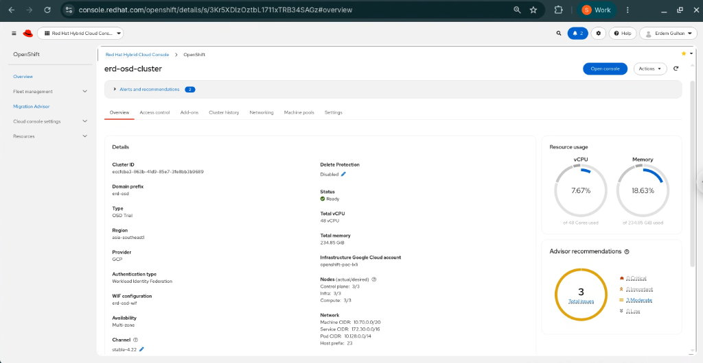
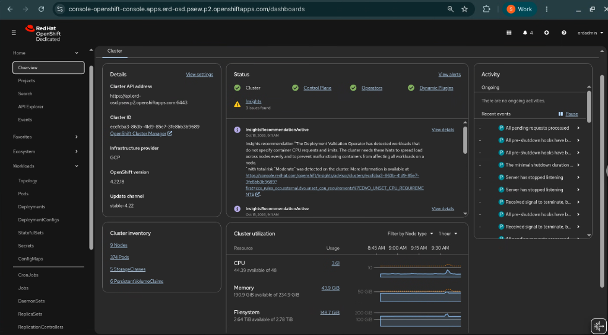
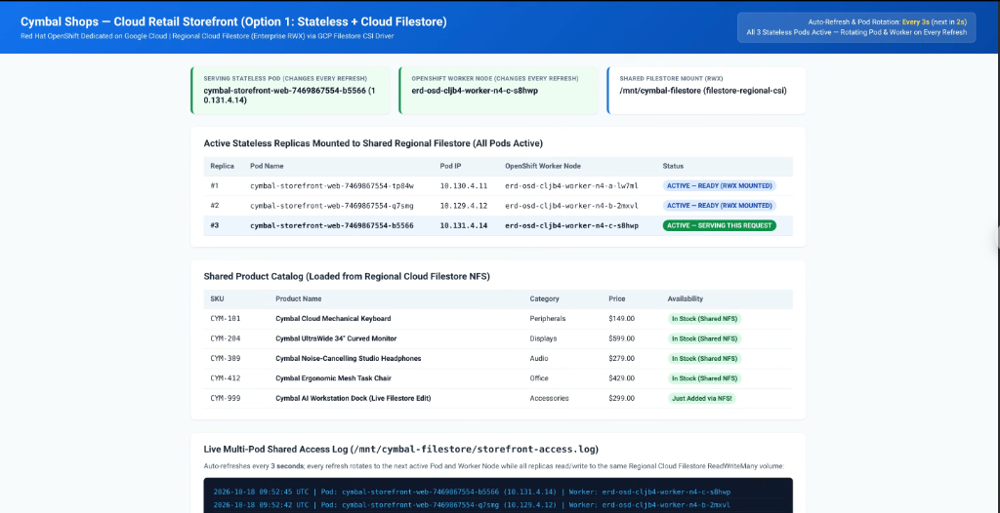
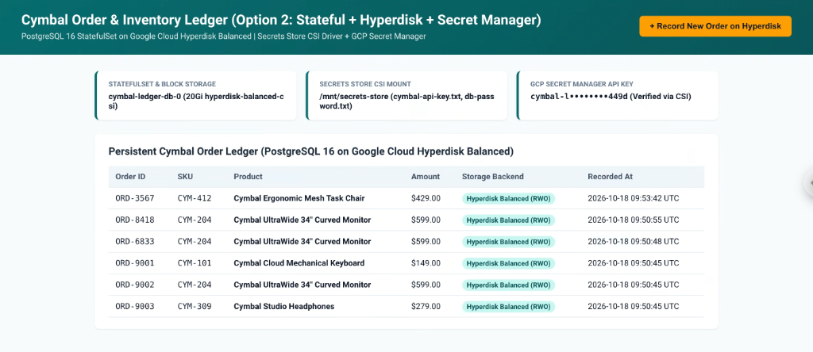

# Red Hat OpenShift Dedicated (OSD) on Google Cloud (Private Cluster Demo)

This repository provides a clean, automated, step-by-step CLI and YAML framework for deploying a **Private Red Hat OpenShift Dedicated (OSD) Customer Cloud Subscription (CCS) Cluster** on **Google Cloud** inside a **new Custom VPC** from a dedicated Linux Bastion VM.

---

## Purpose & Business Value

The purpose of this demo is to showcase an enterprise-ready **Red Hat OpenShift Dedicated (OSD)** reference architecture on **Google Cloud** that combines **Red Hat-managed turnkey Kubernetes operations** with **Google Cloud's native security, resilience, and storage services** to lower Total Cost of Ownership (TCO) and accelerate enterprise adoption:

| Architectural Pillar | Technical Capability | Business Value & Enterprise Outcome |
| :--- | :--- | :--- |
| **Managed & Backed by Red Hat** | **Turnkey OpenShift Dedicated (`OSD`)** with 24×7 Red Hat SRE management, automated upgrades, proactive monitoring via Private Service Connect (PSC), and joint Red Hat + Google Cloud support. | **Operational Efficiency & Reduced Risk**: Offloads Day-2 cluster administration, patching, and control-plane maintenance to Red Hat SREs with a **99.95% uptime SLA**, freeing platform teams to focus on shipping applications. |
| **Private Cluster Architecture** | **100% Private Control Plane, Worker Nodes & Ingress (`--private`)** inside a custom VPC with keyless **Workload Identity Federation (WIF)**, Cloud NAT, and zero-trust **Cloud IAP** bastion tunneling. | **Enterprise Security & Regulatory Compliance**: Eliminates public internet exposure for cluster APIs, workloads, and long-lived service account keys—meeting strict financial, healthcare, and public-sector security postures. |
| **Multi-Zone Topology** | **3-Zone Regional Deployment (`--multi-az`)** distributing Control Plane, Infrastructure, and Worker nodes across three Google Cloud availability zones (`-a`, `-b`, `-c`). | **High Availability & Business Continuity**: Protects mission-critical applications against zone-level outages with automated pod rescheduling, regional storage failover, and zero single points of failure. |
| **Google Cloud Hyperdisk (on N4)** | **Hyperdisk Balanced (`pd.csi.storage.gke.io`)** paired with next-generation **N4 (`n4-standard-4`)** worker nodes for stateful databases (`StatefulSet`). | **Cost Optimization & Lower TCO**: Decouples storage IOPS/throughput from disk size—eliminating the need to over-provision multi-terabyte SSDs just to achieve database performance, significantly reducing storage spend. |
| **Native GCP Service Integration** | First-class OpenShift Operator & CSI integration with **Regional Cloud Filestore** (`ReadWriteMany` shared NFS over Private Service Access) and **Google Cloud Secret Manager** (`secrets-store.csi.k8s.io`). | **Faster Time-to-Market & Unified Governance**: Lets OpenShift workloads consume fully managed Google Cloud storage and centralized enterprise secrets natively without custom glue code or external secret sprawl. |

---

## Key Features

- **Consistent Resource Naming**: A single naming prefix (`PREFIX`, 3–15 chars) names every GCP and OpenShift Dedicated resource (New Custom VPC, 4 Subnets, Cloud Router, Cloud NAT, Firewall rules, WIF configuration / Service Account, SSH key, Bastion VM, and OSD Cluster).
- **Automated `/20` Subnet Carving (New Custom VPC)**: Input any `/20` VPC IP range (e.g., `10.90.32.0/20`) and `00-prereq-config.sh` automatically calculates non-overlapping subnets in the new VPC:
  - **Control Plane Subnet (`/23`)**: `${PREFIX}-subnet-control-plane`
  - **Worker Subnet (`/23`)**: `${PREFIX}-subnet-worker`
  - **Bastion Subnet (`/24`)**: `${PREFIX}-subnet-bastion`
  - **Private Service Connect Subnet (`/29`)**: `${PREFIX}-subnet-psc` (`--purpose=PRIVATE_SERVICE_CONNECT` for Red Hat SRE private management)
- **Declarative YAML + CLI Automation**:
  - Organization Policy overrides (`iam.allowedPolicyMemberDomains` and `compute.trustedImageProjects`) are rendered from YAML templates in `templates/policies/`.
  - Cluster parameters and Day-2 admin RBAC bindings are rendered into `generated/cluster-config.yaml` and `generated/cluster-admin-rbac.yaml` from `templates/`.
- **100% Keyless Workload Identity Federation (WIF)**: Uses keyless **Workload Identity Federation (`ocm gcp create wif-config`)** across both Phase 1 (OSD cluster & built-in operators) and Phase 2 (Filestore CSI & Secret Manager CSI) — **zero Service Account JSON private keys are ever created or exported**.
- **Private Cluster + Cloud NAT + IAP Bastion**: All OSD cluster nodes and the Bastion VM run without public IP addresses (`--private`), using **Cloud NAT** for outbound internet access and **Cloud IAP** for secure SSH and Web Console tunneling.
- **Automated HTPasswd Identity Provider & Admin Login**: `05-bastion-install-osd.sh` automatically configures an `htpasswd` Identity Provider on the OSD cluster, grants `dedicated-admins` and `cluster-admins`, logs in via `oc login`, and populates `~/.kube/config` on the Bastion VM.

---

## Repository Structure

```text
osd-gcp-demo/
├── README.md                              # Project overview, prerequisites & quickstart
├── docs/
│   ├── architecture.md                    # Detailed architecture, /20 network layout, WIF/PSC & sizing
│   ├── architecture-review.md             # Google Cloud Well-Architected & OpenShift Security Review
│   ├── step-by-step-guide.md              # Complete installation, live customer demo & teardown guide
│   └── images/                            # Screenshots of OpenShift Dedicated Web Console & Cymbal Workloads
├── scripts/
│   ├── 00-prereq-config.sh                # Interactive prompt (checks console.cloud.google.com/redhat-openshift/, Project, Region, Prefix, /20 CIDR)
│   ├── 01-policy-check.sh                 # Enables GCP APIs & applies YAML Org Policies
│   ├── 02-vpc-setup.sh                    # Deploys New Custom VPC, 4 Subnets (CP, Worker, Bastion, PSC), Cloud NAT & Firewalls
│   ├── 03-iam-and-keys.sh                 # Creates SSH keypair, keyless Bastion SA, and OSD WIF config
│   ├── 04-bastion-setup.sh                # Renders cluster-config.yaml & RBAC YAML, deploys Bastion VM & copies files
│   ├── 05-bastion-install-osd.sh          # Run manually on Bastion VM to create OSD cluster & configure HTPasswd admin
│   ├── 06-access-and-test.sh              # Discovers OSD URLs, runs connection tests, /etc/hosts setup & Console HTTPS tunnel
│   ├── 07-cleanup.sh                      # Full teardown of OSD cluster, WIF, Bastion, VPC, NAT, Subnets & /etc/hosts
│   └── 08-stop-start-vms.sh               # Gracefully stop, start, or check status of OSD Cluster & Bastion VMs
├── templates/
│   ├── cluster-config.yaml.tpl            # Declarative OSD cluster specification YAML template
│   ├── cluster-admin-rbac.yaml.tpl        # Declarative ClusterRoleBinding YAML for admin user
│   └── policies/
│       ├── allowed-domains.yaml.tpl       # constraints/iam.allowedPolicyMemberDomains (allowAll: true)
│       └── trusted-images.yaml.tpl        # constraints/compute.trustedImageProjects YAML template
└── workloads/                             # Phase 2 & 3 (Optional): Google Cloud Cymbal Demo Workloads
    ├── README.md                          # Phase 2 & 3 overview & quickstart
    ├── sync-to-bastion.sh                 # Syncs workloads/ to ~/osd-setup/workloads/ on the Bastion VM
    ├── docs/
    │   ├── architecture-phase2.md         # Architectural diagrams for Filestore, Hyperdisk, Secret Manager & Public WAF/ALB
    │   ├── option1-filestore-stateless-guide.md
    │   ├── option2-hyperdisk-secrets-stateful-guide.md
    │   └── option3-public-waf-ddos-guide.md
    ├── option1-filestore-stateless/       # Option 1: Stateless Cymbal Storefront + Regional Private Filestore CSI
    ├── option2-hyperdisk-stateful/        # Option 2: Stateful Cymbal Order Ledger + Hyperdisk + Secret Manager CSI
    └── option3-public-waf-ddos/           # Option 3 (Phase 3): Public Edge Storefront + Cloud Armor WAF/DDoS + Cloud CDN + Global ALB
```

---

## Quickstart Workflow (Phase 1: Healthy Environment)

> [!IMPORTANT]
> **Where Each Script Runs**:
> - **Scripts `00` through `04`, `06`, and `07`** run on your **Local Workstation**.
> - **Script `05` (`~/osd-setup/05-bastion-install-osd.sh`)** runs **ONLY inside the Bastion VM** after you SSH into it.
> - **Script `06` (`./scripts/06-access-and-test.sh`)** runs on your **Local Workstation** (not inside the Bastion VM) to test the cluster remotely and open the local port-forwarding tunnel to your browser.

| Step | Script / Command | Where to Run | Description |
| :--- | :--- | :--- | :--- |
| **0** | `./scripts/00-prereq-config.sh` | **Local Workstation** | Confirms OSD prerequisites at [console.cloud.google.com/redhat-openshift/](https://console.cloud.google.com/redhat-openshift/); prompts for GCP Project, Region, Prefix, `/20` CIDR, Subscription (`osdtrial`, `marketplace-gcp`, or `standard`), and Admin user/password; generates `config.env`. |
| **1** | `./scripts/01-policy-check.sh` | **Local Workstation** | Enables required GCP APIs (including `sts.googleapis.com`) and applies YAML Org Policies (Trusted Images and Allowed Member Domains). |
| **2** | `./scripts/02-vpc-setup.sh` | **Local Workstation** | Creates a **new Custom VPC (`${PREFIX}-vpc`)**, 4 Subnets (`control-plane`, `worker`, `bastion`, `psc`), Cloud Router + Cloud NAT, and IAP/Internal/HealthCheck firewall rules. |
| **3** | `./scripts/03-iam-and-keys.sh` | **Local Workstation** | Generates Ed25519 SSH key pair, creates keyless Bastion SA, authenticates `ocm`, and creates the **OSD WIF config (`${PREFIX}-wif`)**. |
| **4** | `./scripts/04-bastion-setup.sh` | **Local Workstation** | Renders `generated/cluster-config.yaml` and `generated/cluster-admin-rbac.yaml`, provisions the private Bastion Linux VM, and copies all setup files to `~/osd-setup/`. |
| **5** | `~/osd-setup/05-bastion-install-osd.sh` | **Bastion VM Only** | SSH into the Bastion VM using the command printed by Step 4 to create the private OSD cluster, wait for `ready`, configure the `htpasswd` IDP + admin user, and populate `~/.kube/config`. |
| **6** | `./scripts/06-access-and-test.sh test` | **Local Workstation** | Discovers the OSD cluster domain (`*.p2.openshiftapps.com`), tests private DNS, API health (`:6443`), Console route (`:443`), and node readiness via the Bastion. |
| **7** | `./scripts/06-access-and-test.sh hosts`<br>`./scripts/06-access-and-test.sh tunnel` | **Local Workstation** | Configures local `/etc/hosts` and opens the IAP HTTPS/HTTP tunnel (`127.0.0.2:443` & `:80`) on your Local Workstation for Web Console access. |
| **8** | `./scripts/08-stop-start-vms.sh [status\|stop\|start]` | **Local Workstation** | Gracefully stops or restarts all OSD Cluster VMs (Workers $\leftrightarrow$ Infra $\leftrightarrow$ Masters) and the Bastion VM when idle to save compute costs, and auto-approves node CSRs on start. |
| **9** | `./scripts/07-cleanup.sh` | **Local Workstation** | Deletes the OSD cluster via `ocm delete cluster` (waiting for GCP resources to deprovision), deletes WIF/SA, Bastion VM, Firewalls, Cloud NAT/Router, Subnets, and the new Custom VPC. |

### Phase 1 Screenshots

#### 1. Red Hat Hybrid Cloud Console — OpenShift Cluster Manager (OCM)



#### 2. Red Hat OpenShift Dedicated 4.22.18 Web Console (via Cloud IAP Tunnel)



---

## Customizing OSD Cluster Settings (`templates/cluster-config.yaml.tpl` & `config.env`)

You can customize the worker machine type, replica count, Multi-AZ mode, or subscription billing model during `./scripts/00-prereq-config.sh` or by editing `config.env` / `templates/cluster-config.yaml.tpl` before running `./scripts/04-bastion-setup.sh`:

```yaml
apiVersion: ocm.openshift.io/v1alpha1
kind: OSDClusterConfig
metadata:
  name: erd-osd01-cluster
  domainPrefix: erd-osd01
spec:
  provider: gcp
  ccs:
    enabled: true
  subscription:
    type: marketplace-gcp
    marketplaceGcpTerms: true
  region: asia-southeast1
  multiAZ: true
  private: true
  gcp:
    projectID: my-gcp-project
    authMode: wif
    wifConfigName: "erd-osd01-wif"
    network:
      vpcName: erd-osd01-vpc
      controlPlaneSubnet: erd-osd01-subnet-control-plane
      computeSubnet: erd-osd01-subnet-worker
      pscSubnet: erd-osd01-subnet-psc
  compute:
    machineType: n2-standard-4
    replicas: 3
```

> [!IMPORTANT]
> **GCP Machine Types in OSD (`--compute-machine-type`) & `--multi-az`**:
> - **`--multi-az` Enabled by Default**: `05-bastion-install-osd.sh` always passes `--multi-az`, distributing the 3 control plane nodes and worker nodes across 3 availability zones (`-a`, `-b`, `-c`). Note that `--multi-az` requires `--compute-nodes` to be a **multiple of 3** (minimum `3`).
> - **Can you use arbitrary custom machine types in OSD?**
>   - **No** — unlike Self-Managed OCP (`install-config.yaml`), where `openshift-install` calls the GCP API directly and accepts any arbitrary custom shape (such as `n4-custom-6-20480`), **OpenShift Dedicated (`ocm create cluster`) validates `--compute-machine-type` against Red Hat OCM's catalog of pre-approved GCP machine types**.
>   - **What is `custom-4-16384`?** In GCP's naming convention, `custom-<vCPUs>-<MB>` without a series prefix (`custom-4-16384` = 4 vCPU, 16 GB RAM; `custom-8-32768` = 8 vCPU, 32 GB RAM) is a **1st-Gen N1 custom machine type**. Red Hat pre-registered specific N1 custom sizes (`custom-4-16384`, `custom-8-32768`, `custom-16-65536`, `custom-4-32768-ext`, etc.) in the OCM catalog, which is why OCM accepts them.
>   - **Recommended Modern Machine Types**: Use predefined **N2 / C2 / M2** shapes from the OCM catalog such as **`n2-standard-4`** (default, 4 vCPU / 16 GB), **`n2-standard-8`**, **`n2-highmem-4`**, or **`c2-standard-4`**.
>   - To list all GCP machine types currently allowed by OCM, run:
>     ```bash
>     ocm get /api/clusters_mgmt/v1/machine_types --parameter search="cloud_provider.id='gcp'" | jq -r '.items[].id'
>     ```

---

## Platform Notes & Solved Issues

- **Free 60-Day Red Hat OpenShift Dedicated Trial License (`osdtrial`) & Quota / Autoscaler Limits**:
  - If you or your organization don't have an active Red Hat OpenShift Dedicated subscription, you can open a Red Hat account for free at [console.redhat.com/openshift](https://console.redhat.com/openshift) and use the **60-day trial license** for the deployment (`05-bastion-install-osd.sh` automatically detects your `osdtrial` quota and provisions the cluster using the 60-day trial SKU).
  - **Worker vCPU Quota (`40 vCPUs`)**: `osdtrial` grants `1` cluster (`cluster|byoc|osdtrial`) and `40` worker vCPUs (`compute.node|cpu|byoc|osdtrial`) — up to **9 × `n4-standard-4` worker nodes** (`36 vCPUs`) in Multi-AZ mode (Control Plane and Infra nodes do not consume trial vCPU quota).
  - **Cluster Autoscaler on `osdtrial` (`CLUSTERS-MGMT-400`)**: OCM's managed Cluster Autoscaler (`autoscale_clusters` capability) is only enabled on paid OSD subscriptions (`osd`). On `osdtrial`, you can either scale worker replicas manually via `ocm edit machinepool --cluster=${CLUSTER_NAME} --replicas=6 worker` or upgrade the trial cluster in-place in the OCM UI (**Upgrade from trial**).
- **Domain Restricted Sharing (`iam.allowedPolicyMemberDomains`) & WIF Creation**:
  - When `ocm gcp create wif-config` runs, it binds federated Red Hat principals (`principalSet://iam.googleapis.com/organizations/...`) to the OSD installer/operator service accounts in your project. If Domain Restricted Sharing (DRS) is enforced on the project, WIF creation fails.
  - **Fix (Automated in `01-policy-check.sh`)**: `01-policy-check.sh` renders and applies `generated/policies/allowed-domains.yaml` (`allowAll: true`) before `03-iam-and-keys.sh` runs.
- **Day-2 Operations & Cluster Upgrades with Keyless WIF (`Manual` CCO Mode)**:
  - On WIF clusters, OpenShift's Cloud Credential Operator (`CCO`) runs in `Manual` mode (`credentialsMode: Manual`). When installing new Day-2 GCP operators/CSI drivers (such as Cloud Filestore CSI or Secret Manager CSI), a one-time WIF binding on a customer-managed Service Account (`${PREFIX}-gcp-sa`) and a keyless `"type": "external_account"` Kubernetes `Secret` in `openshift-cluster-csi-drivers` are required—which `01-prereq-filestore-psa.sh`, `01-prereq-secretmanager.sh`, and `02-deploy-secrets-csi.sh` automate end-to-end.
  - Because `${PREFIX}-gcp-sa` is customer-managed (not an OCM-owned SA) and federated with the cluster's WIF pool via Kubernetes ServiceAccount OIDC tokens, **all Day-2 operations—including minor/z-stream cluster upgrades (`4.22` $\rightarrow$ `4.23`), `ocm gcp update wif-config`, rolling node replacements, MachinePool scaling, and creating new PVCs or `SecretProviderClass` mounts—work seamlessly with zero reconfiguration**.
- **macOS (Intel & Apple Silicon) Compatibility**:
  All local workstation scripts (`00` through `04`, `06`, `07`, `08`, and `workloads/sync-to-bastion.sh`) run natively on macOS:
  1. **Automatic `ocm` Binary Selection (`darwin-arm64` / `darwin-amd64`)**: `03-iam-and-keys.sh` automatically detects `Darwin` and `arm64`/`x86_64` and uses `curl` to download the matching macOS `ocm` binary if not already installed.
  2. **macOS `ocm.json` Config Path Support**: `04-bastion-setup.sh` checks both `~/Library/Application Support/ocm/ocm.json` (macOS default) and `~/.config/ocm/ocm.json` when copying your OCM login token to the Bastion VM.
  3. **Automatic `lo0` Loopback Alias**: When running `./scripts/06-access-and-test.sh tunnel` on macOS, the script automatically runs `sudo ifconfig lo0 alias 127.0.0.2 up` before opening the IAP SSH tunnel.
- **Windows WSL (WSL 2) Compatibility & Setup**:
  1. **Clone inside the Linux filesystem (`~/...`)**: Always clone and run this repository inside your native WSL home directory (e.g., `~/osd-gcp-demo`), **not** under `/mnt/c/...`.
  2. **Automatic `127.0.0.1` Tunnel Binding on WSL**: `00-prereq-config.sh` automatically detects WSL and sets `CONSOLE_LOCAL_IP="127.0.0.1"` in `config.env`.
  3. **Update the Windows `hosts` File for Windows Browsers**: Running `./scripts/06-access-and-test.sh hosts` inside WSL prints a ready-to-copy **Administrator PowerShell** command to add the discovered OpenShift Dedicated Console, OAuth, and Phase 2 Cymbal app hostnames to `C:\Windows\System32\drivers\etc\hosts`.
- **Google Cloud Shell Compatibility**:
  - All installation, verification (`./scripts/06-access-and-test.sh test`), Phase 2 workload (`workloads/`), VM stop/start (`08-stop-start-vms.sh`), and cleanup (`07-cleanup.sh`) scripts run natively in **Google Cloud Shell** (everything except `06-access-and-test.sh hosts` and `tunnel`, which must run on the local machine where your browser is open).
  - Clone the repository into `$HOME` (`~/osd-gcp-demo`) so `config.env` and `generated/` persist across Cloud Shell sessions, and consider running `~/osd-setup/05-bastion-install-osd.sh` inside `tmux` on the Bastion VM so a Cloud Shell browser tab timeout does not interrupt monitoring.

---

## Phase 2 & Phase 3 (Optional): Google Cloud Cymbal Demo Workloads

Phase 2 and Phase 3 provide **three independent workload options** built around **Google Cloud Cymbal** sample applications. You can deploy any option individually or all three side-by-side:

| Option | Workload & Pattern | Google Cloud & OpenShift Integrations | Guide |
| :--- | :--- | :--- | :--- |
| **Option 1** | **Cymbal Retail Storefront**<br>*(Stateless 3-Replica Web App)* | • **GCP Filestore CSI Driver Operator** (`filestore.csi.storage.gke.io`)<br>• **Regional Private Cloud Filestore** (`tier: regional`, `100Gi`, `2000 IOPS`, `ReadWriteMany` `NFSv4.1`)<br>• **Private Service Access (PSA)** `/29` peering to cluster VPC | [Option 1 Guide](workloads/docs/option1-filestore-stateless-guide.md) |
| **Option 2** | **Cymbal Order & Inventory Ledger**<br>*(Stateful PostgreSQL 16 + Web UI)* | • **Google Cloud Hyperdisk Balanced** (`pd.csi.storage.gke.io`, `ReadWriteOnce`)<br>• **Secrets Store CSI Driver Operator** (`secrets-store.csi.k8s.io`)<br>• **Google Cloud Secret Manager** (`csi-secrets-store-provider-gcp`) | [Option 2 Guide](workloads/docs/option2-hyperdisk-secrets-stateful-guide.md) |
| **Option 3 (Phase 3)** | **Cymbal Global Public Storefront**<br>*(Public Edge Exposure from Private OSD)* | • **Google Cloud Armor WAF (OWASP CRS 4.22) & L7 DDoS Rate-Limiting**<br>• **Global External Application Load Balancer (L7)** + **Cloud CDN** + **TLS 1.2+ SSL Policy**<br>• **Zonal `GCE_VM_IP_PORT` NEGs** + **Least-Privilege GFE Firewall Rule** + **Cloud Monitoring Uptime Check** | [Option 3 Guide](workloads/docs/option3-public-waf-ddos-guide.md) |

See [**`workloads/README.md`**](workloads/README.md) and [**`workloads/docs/architecture-phase2.md`**](workloads/docs/architecture-phase2.md) for full architecture diagrams and deployment instructions.

### Phase 2 Screenshots

#### Option 1: Cymbal Shops — Cloud Retail Storefront (Stateless + Regional Cloud Filestore `ReadWriteMany` NFS)



#### Option 2: Cymbal Order & Inventory Ledger (Stateful PostgreSQL + Google Cloud Hyperdisk + Secret Manager CSI)



---

## Documentation Links

- [**Architecture Guide (`docs/architecture.md`)**](docs/architecture.md)
- [**Architecture & Security Review (`docs/architecture-review.md`)**](docs/architecture-review.md)
- [**Step-by-Step Installation & Customer Demo Guide (`docs/step-by-step-guide.md`)**](docs/step-by-step-guide.md)
- [**Phase 2 & 3 Workloads Overview (`workloads/README.md`)**](workloads/README.md)
- [**Phase 2 & 3 Architecture Guide (`workloads/docs/architecture-phase2.md`)**](workloads/docs/architecture-phase2.md)
- [**Option 1: Stateless Cymbal + Regional Filestore Guide (`workloads/docs/option1-filestore-stateless-guide.md`)**](workloads/docs/option1-filestore-stateless-guide.md)
- [**Option 2: Stateful Cymbal + Hyperdisk + Secret Manager Guide (`workloads/docs/option2-hyperdisk-secrets-stateful-guide.md`)**](workloads/docs/option2-hyperdisk-secrets-stateful-guide.md)
- [**Option 3 (Phase 3): Public Edge + Cloud Armor WAF/DDoS + Cloud CDN Guide (`workloads/docs/option3-public-waf-ddos-guide.md`)**](workloads/docs/option3-public-waf-ddos-guide.md)

## Official References & Further Information

- [Google Cloud Console: Red Hat OpenShift on Google Cloud Requirements & Portal](https://console.cloud.google.com/redhat-openshift/)
- [Red Hat OpenShift Dedicated: Planning Your Environment on GCP](https://docs.redhat.com/en/documentation/red_hat_openshift_dedicated/4/html/planning_your_environment/gcp-ccs-prerequisites_osd-planning-environment)
- [Red Hat OpenShift Cluster Manager (OCM) Hybrid Cloud Console](https://console.redhat.com/openshift)
- [Red Hat OpenShift Cluster Manager CLI (`ocm`) Releases](https://github.com/openshift-online/ocm-cli/releases)
- [Google Cloud: Red Hat OpenShift on Google Cloud Overview](https://docs.cloud.google.com/openshift-cluster/openshift-overview)
