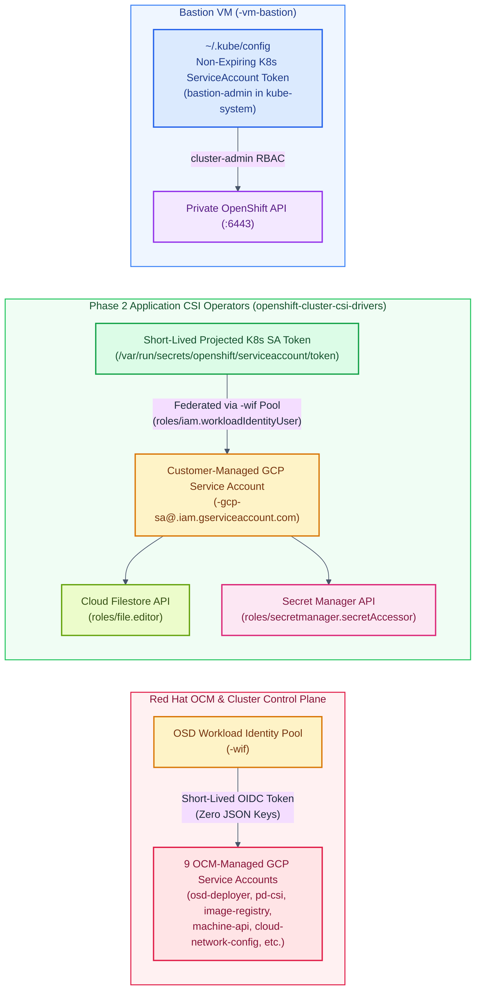

# Architecture & Security Review: Red Hat OpenShift Dedicated (OSD) on Google Cloud

This document provides an engineering and security review of the **Red Hat OpenShift Dedicated (OSD) on Google Cloud** reference architecture implemented in this repository. It evaluates the design across the **five pillars of the Google Cloud Well-Architected Framework** (*Security, Privacy & Compliance*, *Reliability & High Availability*, *Performance Optimization*, *Operational Excellence*, and *Cost Optimization*) and **Red Hat OpenShift Dedicated best practices**.

---

## 1. Executive Summary & Well-Architected Scorecard

| Well-Architected Pillar | Design Rating | Key Architectural Controls Implemented |
| :--- | :--- | :--- |
| **1. Security, Privacy & Compliance** | **Exemplary (Zero-Trust / 100% Keyless)** | • **100% Keyless Workload Identity Federation (`${PREFIX}-wif`)** — zero long-lived GCP Service Account JSON keys. • **100% Private Cluster (`--private`)** — zero public IPs on Control Plane, Infra, Worker, or Bastion VMs. • **Private Service Connect (`PURPOSE=PRIVATE_SERVICE_CONNECT`)** for Red Hat SRE management without public API exposure. • **In-Memory Password Hygiene + Non-Expiring `bastion-admin` Token** — admin passwords are never written to disk. • **Defense-in-Depth Public Edge (Option 3)** — Global External ALB + Google Cloud Armor WAF (`OWASP CRS 4.22`) + L7 Rate-Based Ban + Least-Privilege GFE Firewall (`tcp:30080` only) + OpenShift `restricted-v2` SCC + `NetworkPolicy`. |
| **2. Reliability & High Availability** | **99.95% Multi-Zone HA (`--multi-az`)** | • **3-Zone Distribution (`-a`, `-b`, `-c`)** across Control Plane Masters (3), Dedicated Infra Nodes (3), and Application Worker Nodes (3–6). • **Regional Storage Resilience** via Regional Enterprise Cloud Filestore (`ReadWriteMany` across 3 zones) and Zonal Hyperdisk Balanced (`WaitForFirstConsumer`). • **Multi-Region Synthetic Probing** via Cloud Monitoring Global HTTPS Uptime Checks (USA, Europe, Asia-Pacific). |
| **3. Performance Optimization** | **Next-Gen Compute, Storage & Global Edge** | • **Google Cloud `N4` (`n4-standard-4`) Worker Nodes** powered by 4th Gen Intel Xeon (`Emerald Rapids`) and Titanium offload processors. • **Google Cloud Hyperdisk Balanced** decoupling IOPS/throughput from volume capacity. • **Google Cloud CDN (`CACHE_ALL_STATIC`)** caching storefront catalog assets at 180+ Google Edge POPs (`X-CDN-Cache-Status: HIT`). |
| **4. Operational Excellence** | **Turnkey SRE + Automated Day-2 Lifecycle** | • **24×7 Red Hat SRE Management** for control-plane patching, proactive telemetry, and managed upgrades. • **Separation of Duties for CSI Credentials** — customer-managed `${PREFIX}-gcp-sa` is decoupled from OCM-managed Service Accounts so minor cluster upgrades (`4.22` $\rightarrow$ `4.23`) never disrupt Filestore or Secret Manager CSI mounts. • **100% Edge Audit & Network Telemetry** via Cloud Logging, Firewall Rule Logging, and sampled VPC Flow Logs (`0.1`). |
| **5. Cost Optimization** | **Elastic Scaling & Idle Cost Control** | • **MachinePool Autoscaling (`3–6` workers)** scales compute capacity on demand. • **Hyperdisk Right-Sizing** eliminates over-provisioning multi-TB disks just to meet database IOPS targets. • **Graceful VM Stop/Start (`08-stop-start-vms.sh`)** stops all 9 OSD cluster VMs + Bastion VM when idle (~80–85% compute cost reduction) and auto-approves kubelet CSRs on restart. |

---

## 2. Identity, Access & Credential Hygiene Review

### Key Security Findings & Design Decisions

1. **Elimination of Service Account JSON Keys (`100% Keyless WIF`)**:
   - **Risk Mitigated**: Long-lived GCP Service Account JSON keys are the #1 vector for cloud credential leakage.
   - **Implementation**: Both Phase 1 (`03-iam-and-keys.sh` via `ocm gcp create wif-config`) and Phase 2 (`01-prereq-filestore-psa.sh` and `01-prereq-secretmanager.sh`) use **Google Cloud Workload Identity Federation (`sts.googleapis.com`)** with `"type": "external_account"` credential manifests and projected Kubernetes ServiceAccount OIDC tokens (`/var/run/secrets/openshift/serviceaccount/token`).
2. **Separation of Duties Between OCM SAs and Customer Workload SAs (`${PREFIX}-gcp-sa`)**:
   - **Risk Mitigated**: Modifying OCM-managed Service Accounts (`osd-deployer-*`, `openshift-gcp-pd-csi-driver-*`) risks having custom IAM bindings overwritten when `ocm gcp update wif-config` runs before a minor OpenShift upgrade.
   - **Implementation**: All Phase 2 Day-2 CSI operators (`Filestore CSI` and `Secrets Store CSI GCP Provider`) federate into a dedicated, customer-managed Service Account (`${PREFIX}-gcp-sa`), ensuring 100% upgrade independence.
3. **In-Memory HTPasswd Admin Password & Non-Expiring `bastion-admin` Token**:
   - **Risk Mitigated**: Storing plaintext cluster admin passwords in `config.env` or having OAuth access tokens in `~/.kube/config` expire every 24 hours.
   - **Implementation**: `05-bastion-install-osd.sh` prompts for (or auto-generates) the `htpasswd` admin password strictly in memory during IDP creation, then provisions a dedicated Kubernetes `ServiceAccount` (`bastion-admin` in `kube-system`, bound to `cluster-admin`) and a non-expiring `kubernetes.io/service-account-token` Secret (`bastion-admin-token`) embedded directly into `~/.kube/config` on the Bastion VM.

---

## 3. Network Topology & Defense-in-Depth Edge Security Review

### 3.1 Private Cluster Isolation (`Phase 1 & Phase 2`)
- **Zero Public IP Addresses on Cluster VMs**: All 3 Control Plane Masters, 3 Dedicated Infra Nodes, 3–6 Worker Nodes, and the Bastion VM run with private RFC 1918 IPv4 addresses only (`--private` and `--no-address`).
- **Private Service Connect (`${PREFIX}-subnet-psc`, `/29`)**: Red Hat SRE management traffic traverses a dedicated Google Cloud `ServiceAttachment` inside `${PREFIX}-subnet-psc` (`PURPOSE=PRIVATE_SERVICE_CONNECT`), avoiding public API endpoints or complex bi-directional VPC peering.
- **Cloud IAP Bastion Tunneling (`35.235.240.0/20`)**: Administrative SSH (`:22`) and OpenShift Web Console access (`:443`) require Google IAM authorization through Cloud Identity-Aware Proxy (`${PREFIX}-allow-iap-ssh`).
- **Cloud NAT Dynamic Port Allocation**: Outbound internet access for image pulls (`quay.io`, `registry.redhat.io`) uses Cloud NAT with dynamic port allocation (`min-ports-per-vm=1024`, `max-ports-per-vm=65536`), preventing SNAT port exhaustion under high concurrency.

### 3.2 Hybrid Public Workload Exposure (`Phase 3 / Option 3`)
A common enterprise requirement is exposing customer-facing web applications to the public internet with full WAF/DDoS protection **without converting the OpenShift cluster itself into a public cluster**. Option 3 implements Google Cloud's defense-in-depth edge pattern:

| Defense Layer | Control Implemented | Threat Mitigated |
| :--- | :--- | :--- |
| **Layer 1: Google Anycast Edge** | Global External Application Load Balancer (`EXTERNAL_MANAGED`) + Global Anycast IP (`${PREFIX}-public-waf-vip`) | Absorbs volumetric L3/L4 SYN/UDP floods at 180+ Google POPs before traffic enters the VPC. |
| **Layer 2: Cryptographic Edge** | Google SSL Policy (`MODERN`, `min-tls-version=1.2`) + Edge HSTS / Security Headers (`Strict-Transport-Security`, `X-Frame-Options: DENY`, `X-Content-Type-Options: nosniff`) | Blocks legacy TLS 1.0/1.1, weak ciphers, clickjacking, MIME sniffing, and SSL stripping. |
| **Layer 3: OWASP Top 10 WAF** | Cloud Armor Rules **Priority 1000–1008** (`sqli-v422-stable`, `xss-v422-stable`, `lfi-v422-stable`, `rce-v422-stable`, `scannerdetection-v422-stable`, `protocolattack-v422-stable`, `rfi-v422-stable`, `sessionfixation-v422-stable`, `generic-v422-stable` $\rightarrow$ `403 Forbidden`) | Blocks SQL Injection, Cross-Site Scripting, Path Traversal, Remote Code Execution, RFI/SSRF, Session Fixation, Generic/SSTI injection, scanners, and HTTP smuggling at Google's edge. |
| **Layer 4: L7 DDoS Rate Limiting** | Cloud Armor Rule **Priority 2000** (`rate-based-ban`: `100 req/min/IP` $\rightarrow$ `429 Too Many Requests` for `120s`) | Stops volumetric HTTP/2 floods, credential stuffing, and scraping bots at the edge after OWASP signature inspection. |
| **Layer 5: Edge Offload (Cloud CDN)** | Cloud CDN (`CACHE_ALL_STATIC`) on Global Backend Service | Serves `/static/catalog.json` and static assets directly from Google Edge POPs (`X-CDN-Cache-Status: HIT`), shielding worker pods from traffic spikes. |
| **Layer 6: VPC Perimeter Firewall** | `${PREFIX}-allow-gfe-public-neg` allowing **only** Google Front End ranges (`130.211.0.0/22`, `35.191.0.0/16`) to target tag `<infra-id>-worker` on `tcp:30080` | Prevents direct bypass of Cloud Armor and ensures the OpenShift API (`:6443`) and internal router (`:443`) remain 100% unreachable from the public ALB. |
| **Layer 7: Pod & Namespace Security** | OpenShift `restricted-v2` SCC (`runAsNonRoot: true`, `seccompProfile: RuntimeDefault`, `drop: ["ALL"]`) + `cymbal-public-zero-trust-netpol` | Prevents container privilege escalation and blocks lateral movement from `cymbal-public` to internal namespaces (`cymbal-stateful`, `cymbal-storefront`). |

---

## 4. Compute, Storage & High Availability Review

| Tier | Architecture Choice | Why It Follows Google Cloud & OpenShift Best Practices |
| :--- | :--- | :--- |
| **Control Plane (3 Masters)** | `n2-standard-8` across Zones `-a`, `-b`, `-c` with 1 TiB `pd-ssd` | Managed 24×7 by Red Hat SREs; tolerates full availability zone loss while maintaining etcd quorum and 99.95% uptime SLA. |
| **Dedicated Infra Nodes (3 Nodes)** | 3 RHCOS nodes across Zones `-a`, `-b`, `-c` | Isolates OpenShift Router, Prometheus monitoring, and Integrated Image Registry workloads from application worker nodes (no OpenShift subscription license cost for Infra nodes). |
| **Application Workers (3–6 Nodes)** | `n4-standard-4` across Zones `-a`, `-b`, `-c` + MachinePool Autoscaler (`min=3`, `max=6`) | Next-gen Intel Emerald Rapids vCPUs with native **Hyperdisk** support and automated horizontal node scaling across all 3 zones. |
| **Shared File Storage (Option 1)** | **Regional Cloud Filestore (`tier: regional`, `100Gi`, `2000 IOPS`, `NFSv4.1`)** via `filestore.csi.storage.gke.io` over Private Service Access | Synchronous multi-zone NFSv4.1 replication (`99.99%` regional SLA) with custom 2,000 IOPS performance on a compact 100 GiB share across pods in Zones `-a`, `-b`, and `-c`. |
| **Transactional Block Storage (Option 2)** | **Google Cloud Hyperdisk Balanced** via `pd.csi.storage.gke.io` (`WaitForFirstConsumer`) | Delivers up to 3,000+ IOPS and 140+ MB/s baseline performance on a compact 20 GiB volume without paying for oversized multi-terabyte SSDs. |
| **Enterprise Secrets Management (Option 2)** | **Google Cloud Secret Manager** + **Secrets Store CSI Driver (`secrets-store.csi.k8s.io`)** | Centralizes secret rotation, audit logging, and IAM access control in GCP while mounting secrets in-memory (`tmpfs`) inside OpenShift pods. |

---

## 5. Observability, Day-2 Operations & Cost Governance Review

1. **Full-Stack Security & Network Telemetry**:
   - **Edge Security Logs**: 100% of Global External ALB requests and Cloud Armor WAF evaluations (`VERBOSE` mode) stream into Cloud Logging (`jsonPayload.enforcedSecurityPolicy`).
   - **VPC Perimeter Audit**: Firewall Rule Logging is enabled on `${PREFIX}-allow-gfe-public-neg` and 10% sampled **VPC Flow Logs** are enabled on `${PREFIX}-subnet-worker`.
   - **Synthetic Availability Monitoring**: Cloud Monitoring Global HTTPS Uptime Check (`${PREFIX}-public-uptime-check`) probes `https://cymbal.<PUBLIC_VIP>.nip.io/healthz` every 60 seconds from `USA`, `EUROPE`, and `ASIA_PACIFIC`.
2. **Non-Disruptive Day-2 Cluster Upgrades**:
   - Patch (`Z-stream`) and Minor (`Y-stream`) upgrades are executed rolling node-by-node via OCM (`ocm upgrade cluster` or Hybrid Cloud Console UI) with zero downtime for multi-zone deployments (`cymbal-storefront`, `cymbal-public`).
3. **Automated Idle Cost Governance (`08-stop-start-vms.sh`)**:
   - Non-production and demo clusters can be stopped (`./scripts/08-stop-start-vms.sh stop`) in the exact order recommended by Red Hat (*Workers $\rightarrow$ Infra $\rightarrow$ Masters $\rightarrow$ Bastion*) and restarted (`./scripts/08-stop-start-vms.sh start`) with automated kubelet CSR approval—saving ~80–85% of Compute Engine costs when not actively demonstrating.
