# Architecture: Red Hat OpenShift Dedicated (OSD) Private Cluster on Google Cloud

This document describes the architecture, new Custom VPC network topology, `/20` subnet allocation (including Private Service Connect), keyless Workload Identity Federation (WIF) authentication model, and connectivity design for the Red Hat OpenShift Dedicated (OSD) private cluster on Google Cloud.

---

## 1. High-Level Architecture Diagram

```mermaid
%%{init: {'theme': 'base', 'themeVariables': { 'background': '#ffffff', 'primaryTextColor': '#1e293b', 'lineColor': '#475569'}}}%%
flowchart TB
    subgraph Local["Local Engineer Workstation"]
        GcloudSSH["gcloud compute ssh --tunnel-through-iap"]:::client
        LocalHosts["/etc/hosts -> 127.0.0.2 (or 127.0.0.1 on WSL)\nconsole-openshift-console.apps.<PREFIX>.<ID>.p2.openshiftapps.com\noauth-openshift.apps.<PREFIX>.<ID>.p2.openshiftapps.com"]:::client
        WebBrowser["Local Web Browser (HTTPS :443 / HTTP :80)"]:::client
    end

    subgraph RedHat["Red Hat OpenShift Cluster Manager (OCM) & SRE Plane"]
        OCM_API["OCM API (api.openshift.com)\nCluster Provisioning & IDP Management"]:::redhat
        RH_SRE["Red Hat SRE Management Plane\nConnected via Private Service Connect (PSC)"]:::redhat
    end

    subgraph GCP["Google Cloud Project (<PROJECT_ID>)"]
        WIF["OSD GCP Auth\nKeyless Workload Identity Federation (<PREFIX>-wif)"]:::iam
        IAP["Cloud Identity-Aware Proxy (IAP)\nSource Range: 35.235.240.0/20"]:::network
        RouterNAT["Cloud Router (<PREFIX>-router)\n& Cloud NAT (<PREFIX>-nat)"]:::network
        PrivateDNS["OSD Cloud DNS Private Zone\n<PREFIX>.<ID>.p2.openshiftapps.com"]:::dns

        subgraph VPC["New Custom VPC: <PREFIX>-vpc (/20 CIDR)"]
            subgraph SubBastion["Bastion Subnet: <PREFIX>-subnet-bastion (/24)"]
                Bastion["Bastion Linux VM (<PREFIX>-vm-bastion)\nDebian 13 | e2-standard-4 | 100GB pd-ssd\nNo External IP | Runs ocm, oc & kubectl"]:::bastion
            end

            subgraph SubPSC["PSC Subnet: <PREFIX>-subnet-psc (/29)"]
                PSC_Subnet["Private Service Connect Subnet\n(PURPOSE=PRIVATE_SERVICE_CONNECT)\nHosts OSD ServiceAttachment"]:::network
            end

            subgraph SubCP["Control Plane Subnet: <PREFIX>-subnet-control-plane (/23)"]
                API_ILB["Internal API Load Balancer\napi.<PREFIX>.<ID>.p2.openshiftapps.com:6443"]:::lb
                Master1["Master-0 (Zone a)\nRed Hat SRE Managed"]:::master
                Master2["Master-1 (Zone b)\nRed Hat SRE Managed"]:::master
                Master3["Master-2 (Zone c)\nRed Hat SRE Managed"]:::master
            end

            subgraph SubWorker["Worker & Infra Subnet: <PREFIX>-subnet-worker (/23)"]
                Apps_ILB["Internal Ingress Load Balancer\n*.apps.<PREFIX>.<ID>.p2.openshiftapps.com:443/:80"]:::lb
                Infra1["Infra-a (Zone a)\nRouter & Monitoring"]:::infra
                Infra2["Infra-b (Zone b)\nRouter & Monitoring"]:::infra
                Infra3["Infra-c (Zone c)\nRouter & Monitoring"]:::infra
                Worker1["Worker-a (Zone a)\nn4-standard-4"]:::worker
                Worker2["Worker-b (Zone b)\nn4-standard-4"]:::worker
                Worker3["Worker-c (Zone c)\nn4-standard-4"]:::worker
            end
        end
    end

    Internet["Red Hat Registries & Mirrors\n(quay.io, registry.redhat.io, mirror.openshift.com)"]:::redhat

    WebBrowser --> LocalHosts
    LocalHosts -->|"Port 443 Local Forward"| GcloudSSH
    GcloudSSH -->|"TCP :22"| IAP
    IAP -->|"Firewall: <PREFIX>-allow-iap-ssh"| Bastion
    Bastion -->|"ocm CLI"| OCM_API
    OCM_API -->|"Federated Auth"| WIF
    RH_SRE -.->|"Private Service Connect"| PSC_Subnet
    Bastion -->|"oc CLI (:6443)"| API_ILB
    Bastion -->|"HTTPS Tunnel (:443)"| Apps_ILB
    API_ILB --> Master1 & Master2 & Master3
    Apps_ILB --> Infra1 & Infra2 & Infra3
    Infra1 & Infra2 & Infra3 --> Worker1 & Worker2 & Worker3
    SubBastion & SubCP & SubWorker --> RouterNAT
    RouterNAT -->|"Outbound Only"| Internet
    VPC -.->|"DNS Resolution"| PrivateDNS

    classDef client fill:#e0f2fe,stroke:#0284c7,stroke-width:2px,color:#0c4a6e
    classDef redhat fill:#ffe4e6,stroke:#e11d48,stroke-width:2px,color:#881337
    classDef iam fill:#fef3c7,stroke:#d97706,stroke-width:2px,color:#78350f
    classDef dns fill:#ccfbf1,stroke:#0d9488,stroke-width:2px,color:#134e4a
    classDef network fill:#e0e7ff,stroke:#4f46e5,stroke-width:2px,color:#312e81
    classDef lb fill:#f3e8ff,stroke:#9333ea,stroke-width:2px,color:#581c87
    classDef bastion fill:#dbeafe,stroke:#2563eb,stroke-width:2px,color:#1e3a8a
    classDef master fill:#ffedd5,stroke:#ea580c,stroke-width:2px,color:#7c2d12
    classDef infra fill:#cffafe,stroke:#0891b2,stroke-width:2px,color:#164e63
    classDef worker fill:#dcfce7,stroke:#16a34a,stroke-width:2px,color:#14532d

    style Local fill:#f0f9ff,stroke:#0284c7,stroke-width:1.5px,color:#0c4a6e
    style RedHat fill:#fff1f2,stroke:#e11d48,stroke-width:1.5px,color:#881337
    style GCP fill:#f8fafc,stroke:#64748b,stroke-width:2px,color:#1e293b
    style VPC fill:#ffffff,stroke:#475569,stroke-width:2px,stroke-dasharray: 5 5,color:#1e293b
    style SubBastion fill:#eff6ff,stroke:#3b82f6,stroke-width:1.5px,color:#1e3a8a
    style SubPSC fill:#eef2ff,stroke:#6366f1,stroke-width:1.5px,color:#312e81
    style SubCP fill:#fff7ed,stroke:#f97316,stroke-width:1.5px,color:#7c2d12
    style SubWorker fill:#f0fdf4,stroke:#22c55e,stroke-width:1.5px,color:#14532d
```

---

## 1B. Google Cloud Infrastructure Architecture (Project, VPC, Edge WAF/ALB, LB, DNS, Compute Engine & Storage)

The diagram and table below detail the **Google Cloud Platform (GCP) components** provisioned inside your **GCP Project (`${PROJECT_ID}`)** across Project-Level Services (IAM/WIF, Cloud DNS, Secret Manager, Cloud Storage, Cloud Logging & Cloud Monitoring), Global Edge Protection (Global External ALB, Cloud Armor WAF/DDoS, Cloud CDN), Regional VPC Networking (`${PREFIX}-vpc`, 4 Subnets, Cloud Router/NAT, Firewall Rules, Internal Passthrough Load Balancers, Zonal `GCE_VM_IP_PORT` NEGs, Private Service Connect), Multi-Zone Compute Engine VMs (`Zone a`, `Zone b`, `Zone c`), and Managed Storage (Hyperdisk Balanced & Regional Cloud Filestore):

```mermaid
%%{init: {'theme': 'base', 'themeVariables': { 'background': '#ffffff', 'primaryTextColor': '#1e293b', 'lineColor': '#475569'}}}%%
flowchart TB
    subgraph External["External / Hybrid Planes"]
        Client["Engineer Laptop\n(gcloud IAP Tunnel :22 / :443)"]:::client
        PublicUsers["Public Internet Users & Global Uptime Probers\n(https://cymbal.<PUBLIC_VIP>.nip.io)"]:::client
        RedHatSRE["Red Hat OCM & SRE Plane\n(PSC Producer Project)"]:::redhat
    end

    subgraph GCP_Project["Google Cloud Project: <PROJECT_ID> (Region: <REGION>)"]

        subgraph Global_Edge["Google Cloud Global Edge (Phase 3 / Option 3 Public Workload Exposure)"]
            GlobalALB["Global External Application Load Balancer (EXTERNAL_MANAGED)\n• Global Anycast VIP (<PREFIX>-public-waf-vip)\n• Modern SSL Policy (TLS 1.2/1.3) + Cloud CDN"]:::lb
            CloudArmor["Google Cloud Armor WAF & DDoS Policy (<PREFIX>-cloud-armor-waf)\n• Priority 1000–1008: OWASP CRS 4.22 (SQLi, XSS, LFI, RCE, RFI, Generic -> 403)\n• Priority 2000: L7 Rate-Based Ban (100 req/min -> 429)"]:::iam
        end

        subgraph Project_IAM_DNS["Project-Level Cloud Services (IAM, DNS, Secrets, Storage & Observability)"]
            WIF_Pool["IAM Workload Identity Pool & OIDC Provider\n(<PREFIX>-wif)\n+ 9 OCM Service Accounts & <PREFIX>-gcp-sa"]:::iam
            CloudDNS["Cloud DNS Private Managed Zone\n(<PREFIX>.<4char>.p2.openshiftapps.com)\nBound to <PREFIX>-vpc"]:::dns
            SecretMgr["Google Cloud Secret Manager\n(<PREFIX>-cymbal-db-password, <PREFIX>-cymbal-api-key)"]:::secret
            GCS_Bucket["Cloud Storage (GCS) Bucket\n(OpenShift Integrated Image Registry)"]:::storage
            CloudOps["Cloud Logging & Cloud Monitoring\n• 100% ALB/Cloud Armor WAF Audit Logs\n• VPC Flow Logs + Global HTTPS Uptime Check"]:::secret
        end

        subgraph VPC_Net["Custom VPC Network: <PREFIX>-vpc (/20 CIDR | Regional BGP)"]

            subgraph Net_Edge["VPC Edge, Egress & Security"]
                IAP_Edge["Cloud IAP TCP Forwarding\n(35.235.240.0/20 -> TCP:22)"]:::network
                FW_Rules["VPC Firewall Rules\n• <PREFIX>-allow-iap-ssh\n• <PREFIX>-allow-internal\n• <PREFIX>-allow-gcp-health-checks\n• <PREFIX>-allow-gfe-public-neg (GFE -> tcp:30080)\n• OCM Managed Node/LB Rules"]:::network
                CloudNAT["Cloud Router (<PREFIX>-router)\n+ Cloud NAT (<PREFIX>-nat)\n(Outbound Internet for Private VMs)"]:::network
            end

            subgraph Sub_Bastion["Bastion Subnet: <PREFIX>-subnet-bastion (/24)"]
                CE_Bastion["Compute Engine: <PREFIX>-vm-bastion\n(Zone a | e2-standard-4 | Debian 13 | 100GB pd-ssd)\nAttached SA: <PREFIX>-gcp-sa (No External IP)"]:::bastion
            end

            subgraph Sub_PSC["PSC Subnet: <PREFIX>-subnet-psc (/29 | PURPOSE=PRIVATE_SERVICE_CONNECT)"]
                PSC_Attach["GCP ServiceAttachment\n(Red Hat SRE Private Management Endpoint)"]:::network
            end

            subgraph Sub_CP["Control Plane Subnet: <PREFIX>-subnet-control-plane (/23)"]
                ILB_API["GCP Internal Passthrough Network LB (API & MCS)\n• api.<PREFIX>.<id>.p2.openshiftapps.com (:6443)\n• api-int.<PREFIX>.<id>.p2.openshiftapps.com (:6443 / :22623)"]:::lb
                subgraph CP_VMs["Compute Engine: Control Plane Nodes (3 Zones)"]
                    CE_M0["Master-0 (Zone a)\nn2-standard-8 | RHCOS\n1024GB pd-ssd"]:::master
                    CE_M1["Master-1 (Zone b)\nn2-standard-8 | RHCOS\n1024GB pd-ssd"]:::master
                    CE_M2["Master-2 (Zone c)\nn2-standard-8 | RHCOS\n1024GB pd-ssd"]:::master
                end
            end

            subgraph Sub_Worker["Worker & Infra Subnet: <PREFIX>-subnet-worker (/23 — VPC Flow Logs Enabled)"]
                ILB_Apps["GCP Internal Passthrough Network LB (Ingress Router)\n• *.apps.<PREFIX>.<id>.p2.openshiftapps.com (:443 / :80)"]:::lb
                Zonal_NEGs["Zonal GCE_VM_IP_PORT NEGs (Zones a, b, c)\n<PREFIX>-public-neg-<zone> -> Worker VMs :30080"]:::lb
                subgraph Infra_VMs["Compute Engine: Dedicated Infra Nodes (3 Zones)"]
                    CE_I0["Infra-a (Zone a)\nRHCOS | Runs Router,\nMonitoring & Registry"]:::infra
                    CE_I1["Infra-b (Zone b)\nRHCOS | Runs Router,\nMonitoring & Registry"]:::infra
                    CE_I2["Infra-c (Zone c)\nRHCOS | Runs Router,\nMonitoring & Registry"]:::infra
                end
                subgraph Worker_VMs["Compute Engine: Application Worker Nodes (3 Zones)"]
                    CE_W0["Worker-a (Zone a)\nn4-standard-4 | RHCOS\n128GB hyperdisk-balanced"]:::worker
                    CE_W1["Worker-b (Zone b)\nn4-standard-4 | RHCOS\n128GB hyperdisk-balanced"]:::worker
                    CE_W2["Worker-c (Zone c)\nn4-standard-4 | RHCOS\n128GB hyperdisk-balanced"]:::worker
                end
                Hyperdisk["Google Cloud Hyperdisk Balanced Volumes\n(Zonal Block Storage attached via pd.csi.storage.gke.io\nto N4 Worker Nodes for PostgreSQL StatefulSet)"]:::storage
            end

            subgraph PSA_Peering["Private Service Access (VPC Network Peering: servicenetworking-googleapis-com)"]
                Filestore["Google Cloud Filestore Regional (100Gi | 2000 IOPS | NFSv4.1)\n(/29 Allocated Range: <PREFIX>-psa-range)\nMulti-Zone ReadWriteMany NFSv4.1 via filestore.csi.storage.gke.io"]:::storage
            end
        end
    end

    Client -->|"IAP Tunnel"| IAP_Edge
    IAP_Edge -->|"TCP :22"| CE_Bastion
    PublicUsers -->|"HTTPS :443"| GlobalALB
    GlobalALB --> CloudArmor
    CloudArmor -->|"GFE SDN (:30080)"| Zonal_NEGs
    Zonal_NEGs --> CE_W0 & CE_W1 & CE_W2
    GlobalALB & CloudArmor -.->|"100% Audit Logs"| CloudOps
    CE_Bastion -->|"oc (:6443)"| ILB_API
    CE_Bastion -->|"HTTPS (:443)"| ILB_Apps
    ILB_API --> CE_M0 & CE_M1 & CE_M2
    ILB_Apps --> CE_I0 & CE_I1 & CE_I2
    CE_I0 & CE_I1 & CE_I2 -->|"East-West Pod Network"| CE_W0 & CE_W1 & CE_W2
    CE_W0 & CE_W1 & CE_W2 -->|"CSI Block Attach"| Hyperdisk
    CE_W0 & CE_W1 & CE_W2 -->|"NFSv3 over VPC Peering"| Filestore
    CE_W0 & CE_W1 & CE_W2 -.->|"WIF Token -> Secret Manager CSI"| SecretMgr
    CE_I0 & CE_I1 & CE_I2 -.->|"WIF Token -> Image Registry"| GCS_Bucket
    RedHatSRE -.->|"Private Service Connect"| PSC_Attach
    PSC_Attach -.-> ILB_API
    VPC_Net -.->|"Private DNS Lookup"| CloudDNS
    Sub_Bastion & Sub_CP & Sub_Worker -->|"Egress"| CloudNAT

    classDef client fill:#e0f2fe,stroke:#0284c7,stroke-width:2px,color:#0c4a6e
    classDef redhat fill:#ffe4e6,stroke:#e11d48,stroke-width:2px,color:#881337
    classDef iam fill:#fef3c7,stroke:#d97706,stroke-width:2px,color:#78350f
    classDef dns fill:#ccfbf1,stroke:#0d9488,stroke-width:2px,color:#134e4a
    classDef secret fill:#fce7f3,stroke:#db2777,stroke-width:2px,color:#831843
    classDef storage fill:#ecfccb,stroke:#65a30d,stroke-width:2px,color:#365314
    classDef network fill:#e0e7ff,stroke:#4f46e5,stroke-width:2px,color:#312e81
    classDef lb fill:#f3e8ff,stroke:#9333ea,stroke-width:2px,color:#581c87
    classDef bastion fill:#dbeafe,stroke:#2563eb,stroke-width:2px,color:#1e3a8a
    classDef master fill:#ffedd5,stroke:#ea580c,stroke-width:2px,color:#7c2d12
    classDef infra fill:#cffafe,stroke:#0891b2,stroke-width:2px,color:#164e63
    classDef worker fill:#dcfce7,stroke:#16a34a,stroke-width:2px,color:#14532d

    style External fill:#f8fafc,stroke:#94a3b8,stroke-width:1.5px,color:#1e293b
    style GCP_Project fill:#f8fafc,stroke:#64748b,stroke-width:2px,color:#0f172a
    style Global_Edge fill:#faf5ff,stroke:#9333ea,stroke-width:1.5px,color:#581c87
    style Project_IAM_DNS fill:#fefce8,stroke:#ca8a04,stroke-width:1.5px,color:#713f12
    style VPC_Net fill:#ffffff,stroke:#475569,stroke-width:2px,stroke-dasharray: 5 5,color:#0f172a
    style Net_Edge fill:#eef2ff,stroke:#6366f1,stroke-width:1.5px,color:#312e81
    style Sub_Bastion fill:#eff6ff,stroke:#3b82f6,stroke-width:1.5px,color:#1e3a8a
    style Sub_PSC fill:#f5f3ff,stroke:#7c3aed,stroke-width:1.5px,color:#4c1d95
    style Sub_CP fill:#fff7ed,stroke:#f97316,stroke-width:1.5px,color:#7c2d12
    style CP_VMs fill:#ffedd5,stroke:#fb923c,stroke-width:1px,color:#7c2d12
    style Sub_Worker fill:#f0fdf4,stroke:#22c55e,stroke-width:1.5px,color:#14532d
    style Infra_VMs fill:#ecfeff,stroke:#06b6d4,stroke-width:1px,color:#164e63
    style Worker_VMs fill:#dcfce7,stroke:#4ade80,stroke-width:1px,color:#14532d
    style PSA_Peering fill:#f7fee7,stroke:#84cc16,stroke-width:1.5px,color:#365314
```

### Google Cloud Component Breakdown

| Google Cloud Service | Provisioned Resource(s) | Created By | Scope / Location | Purpose in OpenShift Dedicated |
| :--- | :--- | :--- | :--- | :--- |
| **Resource Manager & Org Policy** | Project `${PROJECT_ID}` + Org Policies (`iam.allowedPolicyMemberDomains`, `compute.trustedImageProjects`, `iam.disableServiceAccountCreation`) | `01-policy-check.sh` | Project | Enables Compute, DNS, IAM, STS, Filestore, Secret Manager, and Service Networking APIs; allows RHCOS/Debian images and WIF principal bindings. |
| **VPC Network** | `${PREFIX}-vpc` (`10.70.0.0/20`) | `02-vpc-setup.sh` | Global (Regional BGP) | Isolated custom-mode VPC hosting all Bastion, Control Plane, Infra, Worker, and PSC resources. |
| **VPC Subnets (4)** | • `${PREFIX}-subnet-control-plane` (`/23`) • `${PREFIX}-subnet-worker` (`/23`) • `${PREFIX}-subnet-bastion` (`/24`) • `${PREFIX}-subnet-psc` (`/29`) | `02-vpc-setup.sh` | Regional (`${REGION}`) | Segregates Control Plane VMs, Infra/Worker VMs, Bastion VM (all with Private Google Access enabled), and the `PRIVATE_SERVICE_CONNECT` NAT subnet. |
| **Cloud Router & Cloud NAT** | `${PREFIX}-router` + `${PREFIX}-nat` | `02-vpc-setup.sh` | Regional (`${REGION}`) | Provides outbound-only internet connectivity (dynamic port allocation `1024–65536`) for private VMs to pull container images and reach Red Hat OCM. |
| **VPC Firewall Rules** | • `${PREFIX}-allow-iap-ssh` (`35.235.240.0/20` $\rightarrow$ `:22`) • `${PREFIX}-allow-internal` (`10.70.0.0/20`) • `${PREFIX}-allow-gcp-health-checks` • `${PREFIX}-allow-gfe-public-neg` (`130.211.0.0/22`, `35.191.0.0/16` $\rightarrow$ `tcp:30080`) • `<infra-id>-*` (OCM-managed node/control-plane rules) | `02-vpc-setup.sh`, OCM Installer & Phase 3 (`02-deploy-cloud-armor-and-alb.sh`) | VPC (`${PREFIX}-vpc`) | Secures SSH via Cloud IAP, enables intra-VPC node/pod traffic, allows GCP LB health probes, restricts public ALB traffic to Google Front Ends (`tcp:30080` only), and isolates cluster nodes. |
| **IAM & Workload Identity Federation (WIF)** | • WIF Pool & OIDC Provider (`${PREFIX}-wif`) • 9 OCM-managed SAs (`osd-deployer-*`, `openshift-gcp-pd-csi-driver-*`, etc.) • Customer-managed SA (`${PREFIX}-gcp-sa`) | `03-iam-and-keys.sh` & `01-prereq-*.sh` | Project / Global | Provides 100% keyless OIDC token federation for OpenShift Control Plane operators, Infra registry, and Phase 2 Filestore & Secret Manager CSI drivers. |
| **Compute Engine (Bastion VM)** | `${PREFIX}-vm-bastion` (`e2-standard-4`, Debian 13, 100 GB `pd-ssd`, Shielded VM) | `04-bastion-setup.sh` | Zonal (`${ZONE}`) | Jump host running `ocm`, `oc`, `kubectl`, and `gcloud` with no external IP; endpoint for Cloud IAP SSH and Web Console port forwarding. |
| **Compute Engine (OSD Cluster VMs — 9 Nodes)** | • **3 × Control Plane Masters** (`<infra-id>-master-0/1/2`) • **3 × Dedicated Infra Nodes** (`<infra-id>-infra-*`) • **3+ × Worker Nodes** (`<infra-id>-worker-*`, `n4-standard-4`) | OCM (`05-bastion-install-osd.sh`) | Multi-Zone (`-a`, `-b`, `-c`) | Runs RHCOS with Shielded VM Secure Boot across 3 availability zones for 99.95% SLA high availability. |
| **Cloud Load Balancing (Internal Passthrough NLB)** | • **API / MCS Internal LB**: `:6443` & `:22623` (backends: 3 Master VMs) • **Application Ingress Internal LB**: `:443` & `:80` (backends: 3 Infra VMs) | OCM & OpenShift Ingress Operator | Regional (`${REGION}`) | Distributes Kubernetes API traffic (`api.*`, `api-int.*`) to Master VMs and HTTPS/HTTP application routes (`*.apps.*`) to OpenShift Router pods on Infra VMs. |
| **Cloud DNS** | • `<prefix>.<4char>.p2.openshiftapps.com.` (Private Zone) • `<infra-id>-private-zone` | OCM Installer | Private Zone (`${PREFIX}-vpc`) | Resolves `api.*`, `api-int.*`, and `*.apps.*` inside `${PREFIX}-vpc` to the Internal Load Balancer VIPs. |
| **Private Service Connect (PSC)** | `ServiceAttachment` in `${PREFIX}-subnet-psc` | OCM Installer | Regional (`${REGION}`) | Allows Red Hat SREs and Hive/OCM to manage and monitor the private cluster without public API endpoints or VPC peering. |
| **Cloud Storage (GCS)** | `<infra-id>-image-registry-*` bucket | OpenShift Image Registry Operator | Regional (`${REGION}`) | Object storage backend for the integrated OpenShift Container Image Registry (`image-registry.openshift-image-registry.svc:5000`). |
| **Google Cloud Hyperdisk** | `hyperdisk-balanced` Zonal Persistent Volumes (`pd.csi.storage.gke.io`) | Phase 2 Option 2 (`StatefulSet`) | Zonal (`-a`, `-b`, `-c`) | Next-gen block storage for N4 worker boot disks and stateful databases (`cymbal-ledger-db` PostgreSQL). |
| **Cloud Filestore + Private Service Access** | VPC Peering (`servicenetworking-googleapis-com`) + Regional Enterprise Filestore instance (`filestore.csi.storage.gke.io`) | Phase 2 Option 1 (`01-prereq-filestore-psa.sh`) | Regional (`${REGION}`) | Multi-zone `ReadWriteMany` (`RWX`) shared NFS storage mounted concurrently across all Cymbal Storefront pods. |
| **Secret Manager** | `${PREFIX}-cymbal-db-password` & `${PREFIX}-cymbal-api-key` | Phase 2 Option 2 (`01-prereq-secretmanager.sh`) | Global / Regional | Stores encrypted application credentials mounted in-memory via the Secret Manager CSI Driver (`secrets-store.csi.k8s.io`). |
| **Google Cloud Armor (WAF & L7 DDoS)** | `${PREFIX}-cloud-armor-waf` (Standard Tier Security Policy) | Phase 3 (`02-deploy-cloud-armor-and-alb.sh`) | Global Edge | Blocks OWASP Top 10 attacks (`sqli`, `xss`, `lfi`, `rce`, `scannerdetection`, `protocolattack`) with `403 Forbidden` and enforces L7 Rate-Based Ban (`100 req/min/IP` $\rightarrow$ `429`). |
| **Global External Application LB + Cloud CDN** | • Global Anycast IP (`${PREFIX}-public-waf-vip`) • SSL Policy (`${PREFIX}-ssl-policy-modern`) + TLS Cert (`${PREFIX}-public-tls-cert`) • Backend Service (`${PREFIX}-public-backend-svc`) + Cloud CDN • Zonal `GCE_VM_IP_PORT` NEGs (`${PREFIX}-public-neg-<zone>`) | Phase 3 (`02-deploy-cloud-armor-and-alb.sh`) | Global Edge $\rightarrow$ Multi-Zone (`-a`, `-b`, `-c`) | Exposes `cymbal-public` at `https://cymbal.<PUBLIC_VIP>.nip.io` with TLS 1.2/1.3, HSTS/security response headers, and Edge caching while keeping OSD worker VMs 100% private. |
| **Cloud Logging & Cloud Monitoring** | • 100% ALB & Cloud Armor WAF Audit Logs • Sampled VPC Flow Logs (`0.1`) & Firewall Rule Logs • Global HTTPS Uptime Check (`${PREFIX}-public-uptime-check`) | Phase 3 (`02-deploy-cloud-armor-and-alb.sh`) | Global | Captures real-time WAF block telemetry, network flow audit trails, and synthetic availability probes from USA, Europe, and Asia-Pacific. |

---

## 2. Naming Convention

Every resource created in the Google Cloud project and Red Hat OCM uses the user-supplied `PREFIX` variable (`3–15` characters) to ensure isolation, clarity, and deterministic cleanup:

| Resource Type | Naming Pattern | Example (`PREFIX=erd-osd`) |
| :--- | :--- | :--- |
| **New Custom VPC** | `${PREFIX}-vpc` | `erd-osd-vpc` |
| **Control Plane Subnet** | `${PREFIX}-subnet-control-plane` | `erd-osd-subnet-control-plane` |
| **Worker Subnet** | `${PREFIX}-subnet-worker` | `erd-osd-subnet-worker` |
| **Bastion Subnet** | `${PREFIX}-subnet-bastion` | `erd-osd-subnet-bastion` |
| **PSC Subnet** | `${PREFIX}-subnet-psc` | `erd-osd-subnet-psc` |
| **Cloud Router** | `${PREFIX}-router` | `erd-osd-router` |
| **Cloud NAT** | `${PREFIX}-nat` | `erd-osd-nat` |
| **IAP Firewall Rule** | `${PREFIX}-allow-iap-ssh` | `erd-osd-allow-iap-ssh` |
| **Internal Firewall Rule** | `${PREFIX}-allow-internal` | `erd-osd-allow-internal` |
| **Health Check Firewall Rule** | `${PREFIX}-allow-gcp-health-checks` | `erd-osd-allow-gcp-health-checks` |
| **GCP Service Account (Bastion & CSI)** | `${PREFIX}-gcp-sa` | `erd-osd-gcp-sa@<project-id>.iam.gserviceaccount.com` |
| **OSD WIF Configuration** | `${PREFIX}-wif` | `erd-osd-wif` |
| **SSH Key Pair** | `${PREFIX}-ssh` / `.pub` | `erd-osd-ssh` / `erd-osd-ssh.pub` |
| **Bastion VM** | `${PREFIX}-vm-bastion` | `erd-osd-vm-bastion` |
| **OSD Cluster Name** | `${PREFIX}-cluster` | `erd-osd-cluster` |
| **OSD Domain Prefix** | `${PREFIX}` | `erd-osd.<4char>.p2.openshiftapps.com` |
| **Private Service Access Range (Option 1)** | `${PREFIX}-psa-range` | `erd-osd-psa-range` |
| **Secret Manager Secrets (Option 2)** | `${PREFIX}-cymbal-db-password` ${PREFIX}-cymbal-api-key | `erd-osd-cymbal-db-password` `erd-osd-cymbal-api-key` |
| **Cloud Armor WAF Policy (Option 3)** | `${PREFIX}-cloud-armor-waf` | `erd-osd-cloud-armor-waf` |
| **Global Static Anycast IP (Option 3)** | `${PREFIX}-public-waf-vip` | `erd-osd-public-waf-vip` |
| **Modern SSL Policy & TLS Cert (Option 3)** | `${PREFIX}-ssl-policy-modern` `${PREFIX}-public-tls-cert` | `erd-osd-ssl-policy-modern` `erd-osd-public-tls-cert` |
| **Global Backend Service & NEGs (Option 3)** | `${PREFIX}-public-backend-svc` `${PREFIX}-public-neg-<zone>` | `erd-osd-public-backend-svc` `erd-osd-public-neg-asia-southeast1-a` |
| **GFE Least-Privilege Firewall (Option 3)** | `${PREFIX}-allow-gfe-public-neg` | `erd-osd-allow-gfe-public-neg` |
| **Cloud Monitoring Uptime Check (Option 3)** | `${PREFIX}-public-uptime-check` | `erd-osd-public-uptime-check` |

---

## 3. Network & Subnet Design (`/20` Allocation in New Custom VPC)

The user provides a single `/20` CIDR block (4,096 IP addresses), from which `00-prereq-config.sh` automatically carves out four non-overlapping subnets in the new Custom VPC (`${PREFIX}-vpc`):

| Subnet Purpose | Subnet Name | Size | Example (`10.90.32.0/20`) | Usable IPs | Purpose / Flags |
| :--- | :--- | :--- | :--- | :--- | :--- |
| **VPC Machine Network** | `${PREFIX}-vpc` | `/20` | `10.90.32.0/20` | 4,092 | `--subnet-mode=custom --bgp-routing-mode=regional` |
| **Control Plane Subnet** | `${PREFIX}-subnet-control-plane` | `/23` | `10.90.32.0/23` | 508 | `--enable-private-ip-google-access` (`--control-plane-subnet`) |
| **Worker Subnet** | `${PREFIX}-subnet-worker` | `/23` | `10.90.34.0/23` | 508 | `--enable-private-ip-google-access` (`--compute-subnet`) |
| **Bastion Subnet** | `${PREFIX}-subnet-bastion` | `/24` | `10.90.36.0/24` | 252 | `--enable-private-ip-google-access` (Bastion VM subnet) |
| **PSC Subnet (OSD)** | `${PREFIX}-subnet-psc` | `/29` | `10.90.37.0/29` | 4 | `--purpose=PRIVATE_SERVICE_CONNECT` (`--psc-subnet`) |
| **Remaining Spare Space** | *(Reserved for future services)* | — | `10.90.37.8` – `10.90.47.255` | ~2,790 | N/A |

### Why Private Service Connect (`${PREFIX}-subnet-psc`, `/29`) is Used
When deploying a **Private OpenShift Dedicated (`--private`)** cluster on Google Cloud with Workload Identity Federation, Red Hat's Hive/OCM provisioning plane and Red Hat SREs establish secure private connectivity into the cluster's control plane using a **Google Cloud Private Service Connect (PSC) ServiceAttachment** placed in `${PREFIX}-subnet-psc`.

### OpenShift Internal Overlay Networks
- **Cluster Network (Pod CIDR)**: `10.128.0.0/14` (`hostPrefix: 23`, allowing up to 510 pods per node)
- **Service Network (Service CIDR)**: `172.30.0.0/16`

### Outbound Internet Access via Cloud NAT
Because both the Bastion VM and the OpenShift Dedicated cluster nodes are deployed as **private instances** (`--private` and `--no-address`), **Cloud Router (`${PREFIX}-router`)** and **Cloud NAT (`${PREFIX}-nat`)** are deployed in the region with:
- `--nat-all-subnet-ip-ranges`
- `--auto-allocate-nat-external-ips`
- `--enable-dynamic-port-allocation` (`min-ports-per-vm=1024`, `max-ports-per-vm=65536`) to prevent SNAT port exhaustion during container image pulls and telemetry reporting.

---

## 4. Keyless GCP Authentication Model (`Workload Identity Federation`)

`03-iam-and-keys.sh` configures **100% Keyless Workload Identity Federation (WIF)** for OpenShift Dedicated on GCP:
- Runs `ocm gcp create wif-config --name ${PREFIX}-wif --project ${PROJECT_ID}`.
- Automatically provisions a GCP Workload Identity Pool & OIDC Provider, custom IAM roles, and the OCM-managed OSD installer/operator service accounts (`osd-deployer-*`, `osd-ccs-admin-*`, `openshift-gcp-ccm-*`, `openshift-machine-api-gcp-*`, and in-cluster operator SAs) using short-lived federated OIDC tokens—without creating or storing any long-lived Service Account JSON keys.

---

## 5. Organization Policies & Private Console Access Flow

### Organization Policies (`01-policy-check.sh` + `templates/policies/*.yaml.tpl`)
1. **`constraints/iam.allowedPolicyMemberDomains` (`allowAll: true`)**: Required so `ocm gcp create wif-config` can bind federated `principalSet://iam.googleapis.com/organizations/...` principals and Red Hat SRE accounts without being blocked by Domain Restricted Sharing (DRS).
2. **`constraints/compute.trustedImageProjects`**: Allows `projects/debian-cloud` (Bastion VM), `projects/rhel-cloud`, `projects/rhcos-cloud` (RHCOS nodes), `projects/redhat-marketplace-public`, and `projects/mpi-redhat-marketplace-public`.
3. **Service Account Creation (`iam.disableServiceAccountCreation`, `iam.managed.disableServiceAccountCreation`)**: Set to `enforce: false`.

### Private DNS & Web Console Access Flow
1. During OSD cluster provisioning, Red Hat OCM creates a **Cloud DNS Private Managed Zone** for `<DOMAIN_PREFIX>.<4char-id>.p2.openshiftapps.com` bound to `${PREFIX}-vpc`.
2. Internal Load Balancers are provisioned inside `${PREFIX}-vpc` for:
   - `api.<DOMAIN_PREFIX>.<id>.p2.openshiftapps.com:6443`
   - `*.apps.<DOMAIN_PREFIX>.<id>.p2.openshiftapps.com:443` & `:80`
3. `06-access-and-test.sh` automatically queries OCM to discover the assigned `<DOMAIN_PREFIX>.<id>.p2.openshiftapps.com` domain, maps `console-openshift-console.apps...` and `oauth-openshift.apps...` to `127.0.0.2` (or `127.0.0.1` on WSL2) in `/etc/hosts`, and opens a single IAP SSH tunnel through `${PREFIX}-vm-bastion`.

---

## 6. Official References

- [Google Cloud Console: Red Hat OpenShift Requirements & Portal](https://console.cloud.google.com/redhat-openshift/)
- [Red Hat OpenShift Dedicated: Planning Your Environment on GCP](https://docs.redhat.com/en/documentation/red_hat_openshift_dedicated/4/html/planning_your_environment/gcp-ccs-prerequisites_osd-planning-environment)
- [Red Hat OpenShift Cluster Manager (OCM)](https://console.redhat.com/openshift)
