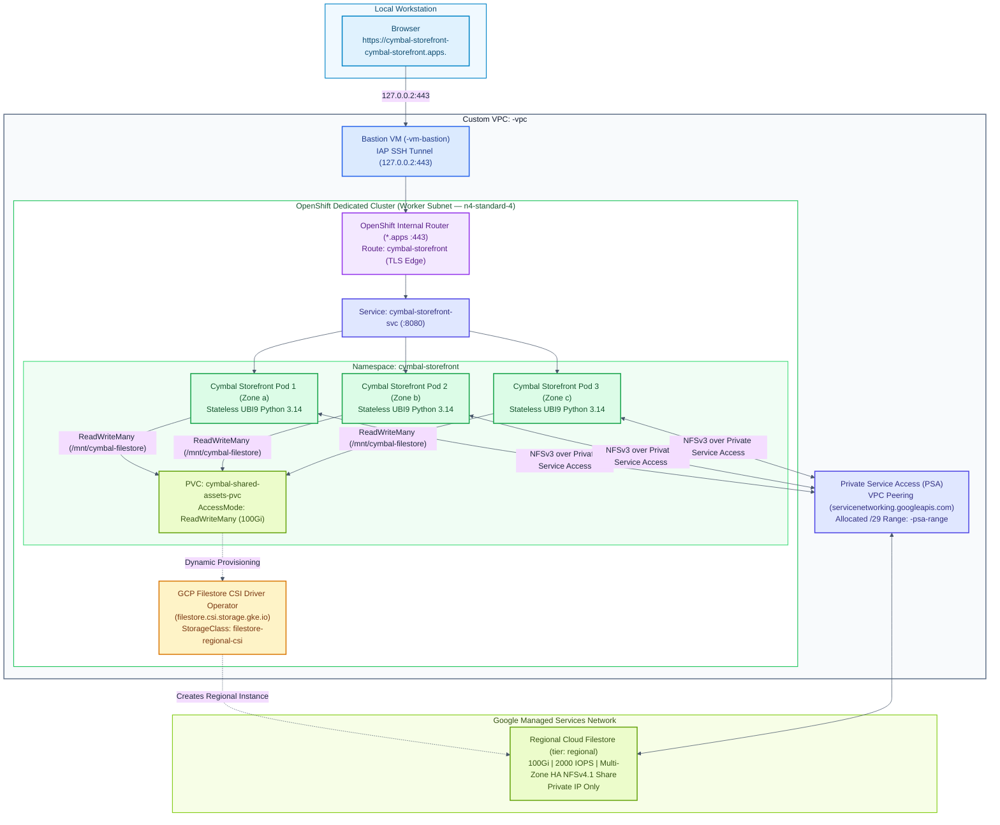
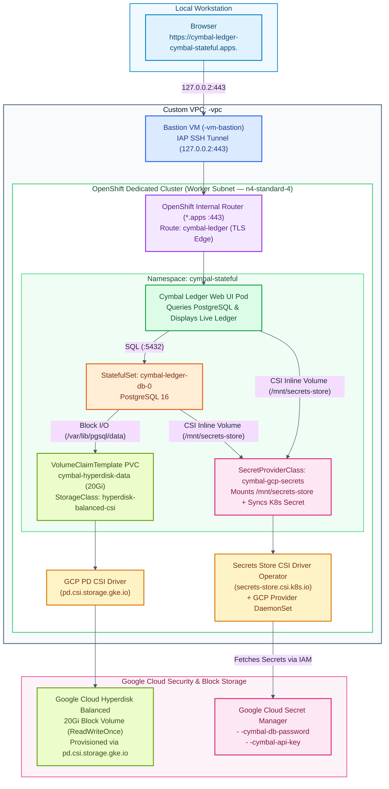
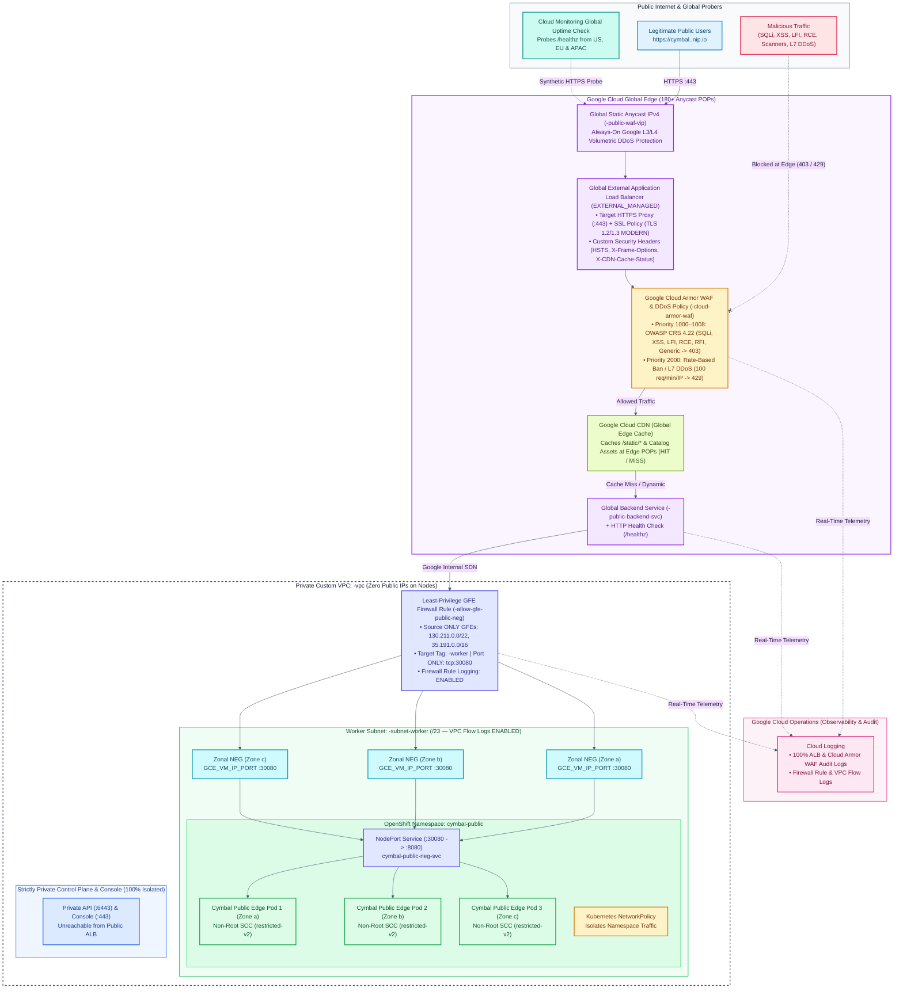

# Phase 2 Architecture: Cymbal Workloads on OpenShift Dedicated & Google Cloud

This document describes the architecture for the two independent Phase 2 workload options running on the private Red Hat OpenShift Dedicated (OSD) cluster in your custom VPC on Google Cloud.

---

## Option 1 Architecture: Stateless Cymbal Storefront with Regional Private Cloud Filestore

Option 1 demonstrates how a **stateless, multi-replica web tier** (`Cymbal Retail Storefront`) scales horizontally across multiple availability zones while reading and writing shared assets and real-time access logs on a **regional, private Google Cloud Filestore (`Enterprise` tier)** volume provisioned dynamically via the **GCP Filestore CSI Driver Operator**.

### Key Architectural Components (Option 1)
1. **Private Service Access (PSA) & VPC Peering**:
   - Because the OpenShift Dedicated cluster is strictly private and uses custom subnets, regional Cloud Filestore (`Enterprise` tier) connects to `${PREFIX}-vpc` via **Private Service Access** (`servicenetworking.googleapis.com`) using a dedicated `/20` peering IP range (`${PREFIX}-psa-range`).
2. **GCP Filestore CSI Driver Operator**:
   - Installed in `openshift-cluster-csi-drivers` via Operator Lifecycle Manager (OLM) and managed through `ClusterCSIDriver` (`filestore.csi.storage.gke.io`).
   - On OSD clusters using Workload Identity Federation (where the Cloud Credential Operator runs in `Manual` mode), `01-prereq-filestore-psa.sh` provisions the `gcp-filestore-cloud-credentials` secret in `openshift-cluster-csi-drivers` so the CSI controller authenticates seamlessly.
   - Provides dynamic provisioning of regional `ReadWriteMany` (`RWX`) NFSv4.1 volumes (`100Gi`, `2000 IOPS`) via `StorageClass` `filestore-regional-csi` (`tier: regional`, `protocol: NFS_V4_1`, `max-iops: "2000"`, `connect-mode: PRIVATE_SERVICE_ACCESS`).
3. **Cymbal Retail Storefront (Stateless Multi-Replica Deployment)**:
   - Runs 3 stateless web replicas spread across worker nodes in 3 zones (`--multi-az`).
   - All 3 pods concurrently mount `/mnt/cymbal-filestore` (`ReadWriteMany`), sharing product catalog assets and appending real-time pod/node request telemetry so users can observe multi-pod `RWX` storage sharing in real time.

---

## Option 2 Architecture: Stateful Cymbal Ledger with Hyperdisk Block Storage & Secret Manager

Option 2 demonstrates how a **stateful database and transaction ledger** (`Cymbal Order & Inventory Ledger`) persists transactional data on **Google Cloud Hyperdisk Balanced** block storage (`ReadWriteOnce`) while mounting database credentials and API keys directly from **Google Cloud Secret Manager** using the **Secrets Store CSI Driver Operator**.

### Key Architectural Components (Option 2)
1. **Google Cloud Hyperdisk Balanced (`hyperdisk-balanced-csi`)**:
   - Uses the built-in OpenShift `pd.csi.storage.gke.io` CSI driver with `type: hyperdisk-balanced` and `volumeBindingMode: WaitForFirstConsumer`, matching the `n4-standard-4` worker nodes' next-generation Hyperdisk storage architecture.
2. **Secrets Store CSI Driver Operator + GCP Provider**:
   - Installs the OpenShift **Secrets Store CSI Driver Operator** (`secrets-store.csi.k8s.io`) and the **Google Cloud Provider DaemonSet** (`csi-secrets-store-provider-gcp`) in `openshift-cluster-csi-drivers`.
   - Uses a `SecretProviderClass` (`cymbal-gcp-secrets`) to fetch secrets directly from **Google Cloud Secret Manager** (`${PREFIX}-cymbal-db-password` and `${PREFIX}-cymbal-api-key`), mounting them as in-memory tmpfs files at `/mnt/secrets-store` and syncing them to an OpenShift `Secret` for database initialization.
3. **Cymbal Order & Inventory Ledger (`StatefulSet` + Web Dashboard)**:
   - **`cymbal-ledger-db` (`StatefulSet`)**: Runs PostgreSQL 16 backed by a dedicated 20 GiB `hyperdisk-balanced` persistent volume (`cymbal-hyperdisk-data-cymbal-ledger-db-0`).
   - **`cymbal-ledger-ui`**: Seeds and queries Cymbal retail inventory and order ledger records stored in PostgreSQL on Hyperdisk, displaying live database records, Hyperdisk volume metadata, and Secret Manager CSI mount verification.

---

## Option 3 (Phase 3) Architecture: Public Edge Storefront with Cloud Armor WAF, DDoS, Cloud CDN & Global External ALB

Option 3 demonstrates how to expose a **public-facing enterprise workload** (`Cymbal Global Public Storefront`) from a **100% Private OpenShift Dedicated (`--private`)** cluster using Google Cloud's defense-in-depth edge security and observability stack—while keeping the OpenShift API (`:6443`), Web Console, OAuth server, and worker nodes completely private (zero public IP addresses on cluster nodes):

### Key Architectural Components (Option 3)
1. **Google Cloud Armor WAF & L7 DDoS (`${PREFIX}-cloud-armor-waf`)**:
   - Blocks OWASP Top 10 attacks (`sqli-v422-stable`, `xss-v422-stable`, `lfi-v422-stable`, `rce-v422-stable`, `scannerdetection-v422-stable`, `protocolattack-v422-stable`, `rfi-v422-stable`, `sessionfixation-v422-stable`, `generic-v422-stable`) at Google's Global Edge (`403 Forbidden`) and enforces per-IP L7 rate limiting (`100 req/min` $\rightarrow$ `429 Too Many Requests` ban for `120s`).
2. **Global External Application Load Balancer (`EXTERNAL_MANAGED`) + Cloud CDN + SSL Policy**:
   - Terminates HTTPS (`:443`) using a `MODERN` TLS 1.2+ SSL Policy, caches `/static/catalog.json` at 180+ Google Edge POPs via **Cloud CDN**, and injects security response headers (`Strict-Transport-Security`, `X-Content-Type-Options: nosniff`, `X-Frame-Options: DENY`).
3. **Zonal `GCE_VM_IP_PORT` NEGs + Least-Privilege GFE Firewall Rule**:
   - Routes clean traffic over Google's internal SDN directly to private worker VMs across Zones `-a`, `-b`, `-c` on NodePort `:30080`, restricted by `${PREFIX}-allow-gfe-public-neg` (`130.211.0.0/22`, `35.191.0.0/16` only) with Firewall Rule Logging and sampled VPC Flow Logs enabled.
4. **Cloud Logging & Cloud Monitoring Global Uptime Check**:
   - Streams 100% of ALB and Cloud Armor security events into Cloud Logging and continuously probes `/healthz` from USA, Europe, and Asia-Pacific via Cloud Monitoring.

---

## Day-2 Lifecycle & Cluster Upgrade Resilience (Keyless WIF)

Because OpenShift Dedicated WIF clusters run the **Cloud Credential Operator (`CCO`)** in `Manual` mode:
1. **One-Time CSI Setup (Automated)**: When deploying Option 1 (`Filestore CSI`) or Option 2 (`Secret Manager CSI`), the prerequisite scripts (`01-prereq-filestore-psa.sh`, `01-prereq-secretmanager.sh`, and `02-deploy-secrets-csi.sh`) bind `roles/iam.workloadIdentityUser` on your dedicated customer-managed Service Account (`${PREFIX}-gcp-sa`) to the cluster's existing GCP Workload Identity Pool and populate the keyless `"type": "external_account"` Kubernetes `Secret` (`gcp-filestore-cloud-credentials` / `gcp-secrets-store-cloud-credentials`) in `openshift-cluster-csi-drivers`.
2. **Zero Impact During Day-2 Operations**:
   - **Cluster Upgrades (`4.22` $\rightarrow$ `4.23`) & `ocm gcp update wif-config`**: Because `${PREFIX}-gcp-sa` is customer-managed (not an OCM-owned SA), pre-upgrade WIF updates never overwrite its Filestore or Secret Manager IAM roles.
   - **Node Replacements & MachinePool Scaling**: Authentication uses projected Kubernetes ServiceAccount OIDC tokens (`/var/run/secrets/openshift/serviceaccount/token`), so replacing worker nodes or adding new MachinePools requires no credential changes.
   - **New PVCs & Secrets**: Any additional Filestore `PersistentVolumeClaim` or Secret Manager `SecretProviderClass` created later works automatically.
